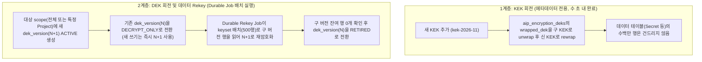

# 13. 제품 서비스 방언의 필드 암호화 설계 (2026-10-18)

> 상태: Proposed (창시자 승인 대기). 코드는 수정하지 않았으며, 1.0 공개 계약 편입을 위한 설계 정본과 결정 근거를 담는다.
> 기준 문서: `docs/PRINCIPLES.md`, `docs/DECISIONS.md`, `docs/design/12-design-reset.md`, `spec/definition-syntax.md`, `spec/definition-diagnostics.md`, `spec/wire-errors.md`.

---

## 0. 배경과 설계 관문 점검

### 0.1 배경: Infisical 포팅에서 확인된 1.0 결함

원본 Infisical은 비밀 관리 서비스로서 프로젝트 단위 데이터 키(Project DEK)와 서버 측 KMS(Root KEK)를 결합한 봉투 암호화(Envelope Encryption)를 기본으로 사용한다(`plan-docs/porting/INFISICAL-KEYMODEL.md:3-17`). 그러나 AIP 제품 서비스 방언(`.aip`, `aip service check`)으로 포팅한 `porting/infisical/app.aip`를 독립 검증한 결과 다음 결함이 확인됐다.

1. **제품 방언 파서의 `encrypted` 수정자 전면 거부**:
   - 필드 타입 꼬리 수정자 형태(`value: Text encrypted`): `spikes/spike-v1-fixture/src/parser.rs:262-297`의 `type_ref()`는 `<TypeName>[.Id][(range|p,s)][?][default database]`만 허용한다. 뒤에 `encrypted`가 오면 `parser.rs:314-326`의 `fields()` 루프가 이를 다음 필드 이름으로 읽고 `:` 토큰을 기대하며 `DEF.PARSE_EXPECTED`를 발생시킨다.
   - 리소스 수준 키워드 형태(`encrypted value` 또는 `encrypted: ...`): `spikes/spike-v1-fixture/src/parser.rs:309-372`와 `spikes/spike-v1-fixture/src/codes.rs:78`은 리소스 블록 키를 `fields`, `rows`, `field`, `expose`, `aggregate`, `transition`, `unique`, `check`, `invariant`, `extension`, `docs` 11개로 고정한다. 그 외 키는 `DEF.PARSE_UNKNOWN_KEY`로 거부된다.
   - 필드 정책 절 형태(`field value encrypted`): `spikes/spike-v1-fixture/src/parser.rs:331-336`은 `field <name>` 뒤에 반드시 `read when <expr>`을 요구하므로 `DEF.PARSE_EXPECTED`로 거부된다.
   - 호스트 리터럴 형식(`.h.ts`, `.h.py`)에서도 `spikes/spike-v1-fixture/src/hmap.rs:141-167`이 동일한 리소스 키 목록과 `parse_type_str()`(`parser.rs:15-19`)을 공유하므로 세 형태 모두 거부된다.
2. **암호화·재암호화(rekey) 런타임의 PoC 격리**:
   - `AIP_ENCRYPTION_KEYS` 기반 AES-256-GCM 암호화(`crates/aip-runtime/src/crypto.rs:1-331`)와 배치 재암호화(`crates/aip-runtime/src/rekey.rs:1-132`)는 PoC 전용 크레이트(`crates/aip-runtime`, `.aipoc`)에만 존재한다.
   - 제품 경로(`spikes/spike-v1-fixture`, `spikes/spike-v2-read`, `spikes/spike-v3-write`, `spikes/spike-v6-transport`, `crates/aip-service`, `crates/aip-migrate`)는 `crates/aip-runtime`을 참조하지 않는다.
   - 그 결과 `porting/infisical/app.aip:4-5,134`와 `plan-docs/porting/INFISICAL-DESIGN.md:19,52`처럼 `Secret.valueCiphertext: Text?` 평문 컬럼으로 우회할 수밖에 없었고, 비밀 관리 앱과 개인정보(PII·금융·의료) 취급 앱을 AIP 1.0 제품 방언으로 구현할 수 없다.

### 0.2 `docs/PRINCIPLES.md` §4 설계 관문 8문항 답

`docs/PRINCIPLES.md:45-54` 및 `docs/design/12-design-reset.md:23`의 규칙에 따라 8개 관문에 먼저 답한다.

1. **화면·기능 하나를 추가할 때 서버 쪽에 무엇을 더 써야 하나?**
   - 0줄이다. 리소스 정의의 필드에 `encrypted` 선언이 한 번 들어가면, 읽기(`/read`)와 쓰기(`/apply`, `create`, `patch`)에서 호출자는 일반 필드와 같은 요청 형식을 쓰고 서버가 암·복호화, AAD 바인딩, 감사 마스킹을 자동 수행한다.
2. **호출자가 자기에게 필요한 데이터 모양·조건을 서버 수정 없이 표현할 수 있나?**
   - 있다. 호출자는 `expose read`에 열린 암호화 필드를 일반 필드와 똑같이 `select`로 골라 읽고, `lookup: eq`가 선언된 암호화 필드는 `filter`의 `eq`/`in` 조건과 `target.where`에 그대로 조합할 수 있다.
3. **권한 없는 데이터 접근이 어떤 경로(읽기, 필터, 정렬, 집계, 에러, 타이밍)로든 가능한가?**
   - 불가능하도록 차단한다. 확률적 암호화 필드는 DB 내 순서·부분 일치가 정의되지 않으므로 `sort`, `cursor`, `contains`, `prefix`, 범위 비교(`gt`/`gte`/`lt`/`lte`), 수치 집계(`sum`/`min`/`max`)를 컴파일 시점(`DEF.*`)과 런타임(`WIRE.*`) 양쪽에서 거부한다. `field <f> read when <cond>`가 붙은 암호화 필드는 SQL의 `CASE WHEN <cond> THEN <col> END` 판정을 통과한 행만 서버가 복호화하므로, 권한 없는 호출자는 복호화 연산 자체를 유발할 수 없다.
4. **클라이언트 입력이 실행 구조(SQL, 코드, 권한 규칙)가 되는 지점이 있나?**
   - 없다. 평문 입력은 스칼라 타입·범위 검증(`spikes/spike-v2-read/src/scalar.rs`)을 거친 뒤 서버 메모리에서 AES-256-GCM 암호문 문자열로 변환되어 바인드 파라미터(`$n::text`)로만 전달된다.
5. **보안·정합성·비용 상한을 빼먹을 수 있나?**
   - 빼먹을 수 없다. 정의에 `encrypted` 필드가 하나라도 있으면 `aip service run` 기동 시점(`preflight`)에 키 공급자 설정과 활성 키 존재 여부를 검증하고, 누락 시 기동을 거부한다. 한 번의 읽기·쓰기 요청이 복호화·암호화할 수 있는 셀 개수는 기존 `budget.rows`, `traverse.limit`, `bulk maxRows`(`spikes/spike-v1-fixture/src/sema.rs:922-947,1514-1522`)로 상한이 강제된다.
6. **같은 의도를 표현하는 방법이 둘 이상인가?**
   - 아니다. 필드 암호화는 필드 타입 뒤의 `encrypted` 꼬리 수정자 한 가지로만 선언한다. 리소스 블록에 별도 `encrypted` 절을 두거나 `field x encrypted` 같은 중복 문법을 두지 않는다(SY-5, `docs/PRINCIPLES.md:50`).
7. **수단(언어, IR, 컴파일러)의 깔끔함을 위해 목적(1, 2, 3)을 희생하고 있지 않나?**
   - 희생하지 않는다. 암호화 키 공급자(환경 변수, 파일, 외부 KMS)와 키 식별자는 운영 설정(`service.json`)에 두고, 도메인 정의(`.aip`)에는 "이 필드가 어떤 범위로 암호화되는가"라는 도메인 의도만 남긴다.
8. **추상 예제가 아니라 아리아리 실제 코드와 Infisical 포팅에서 통하는가?**
   - 통한다. `porting/infisical/app.aip:134`의 `Secret.valueCiphertext`, `SecretVersion.valueCiphertext`(`app.aip:148`), `SecretBlindIndexData.encryptedSaltCiphertext`(`app.aip:326`)를 즉시 선언적 암호화 필드로 전환할 수 있으며, 아리아리의 계좌번호·연락처·외부 연동 토큰처럼 동등 비교(`lookup: eq`)가 필요한 개인정보 케이스도 수용한다.

---

## 1. 선언 문법과 진단 코드

### 1.1 선언 문법 (5개 작성 형식 단일 정규화)

제품 방언은 5개 작성 형식(`.aip`, `.e.ts`, `.e.py`, `.h.ts`, `.h.py`)이 완전히 같은 AST(`spikes/spike-v1-fixture/src/ast.rs`)와 같은 실행 IR(`execution` JSON 및 SHA-256 digest)로 수렴해야 한다(`spikes/spike-v1-fixture/src/lib.rs:22-70`).

5개 형식 모두가 `parse_type_str()`(`spikes/spike-v1-fixture/src/parser.rs:15-19`, `hmap.rs:165`)을 통해 필드 타입 문자열을 파싱하므로, `encrypted`는 **필드 타입 표현식의 꼬리 수정자(trailing modifier)** 로 정의한다.

#### 문법 규칙 (EBNF 확장)

기존 `spec/definition-syntax.md:62-84` 및 `parser.rs:262-297`의 필드 타입 문법을 다음과 같이 확장한다.

```ebnf
FieldType      ::= BaseType RangeOrScale? "?"? DefaultDb? EncryptedMod?
EncryptedMod   ::= "encrypted" ( "(" EncryptedOpt ( "," EncryptedOpt )* ")" )?
EncryptedOpt   ::= "scope" ":" ScopeTarget
                 | "lookup" ":" "eq"
ScopeTarget    ::= "service"
                 | "owner"
                 | Ident          (* 같은 resource 안의 필수 비암호화 Ref<T> 필드 이름 *)
```

- 수정자 순서는 `BaseType` → `(범위 또는 정밀도)` → `?`(nullable) → `default database` → `encrypted(...)`로 고정한다. 순서를 바꾸면 `DEF.PARSE_EXPECTED`로 거부하여 같은 의도가 두 모양으로 쓰이지 않게 한다(SY-5).
- 괄호 옵션이 없는 `encrypted`는 `encrypted(scope: service)`와 같은 뜻이다(유일한 기본값 축약이며, 괄호 안에 `scope: service`를 명시적으로 적는 것은 정규형 중복을 막기 위해 `DEF.ENCRYPTED_REDUNDANT_OPTION`으로 거부한다).
- `encrypted` 옵션 키는 `scope`, `lookup` 두 개뿐이며, 중복 키나 알 수 없는 키는 거부한다(SY-6).

#### 작성 예 (Form A `.aip` 및 Form H `.h.ts`)

```aip
resource Secret {
  fields {
    project: Project
    environment: Environment
    folder: SecretFolder
    key: Text(1..255)
    value: Text(1..10000)? encrypted(scope: project)
    blindTag: Text(1..255)? encrypted(scope: project, lookup: eq)
    personalNote: Text(1..2000)? encrypted(scope: owner)
    systemToken: Text(1..500) encrypted
  }
}
```

호스트 리터럴(`.h.ts` / `.h.py`)에서는 `fields` 객체의 타입 문자열이 그대로 `parse_type_str()`을 거치므로 별도 객체 키를 늘리지 않는다(`spikes/spike-v1-fixture/src/hmap.rs:163-167`):

```ts
fields: {
  project: "Project",
  key: "Text(1..255)",
  value: "Text(1..10000)? encrypted(scope: project)",
  blindTag: "Text(1..255)? encrypted(scope: project, lookup: eq)",
}
```

### 1.2 키 범위(`scope`)와 봉투 암호화(Envelope Encryption)

필드 암호화의 키 범위는 3단계로 정의하며, 이를 통해 단일 서비스 비밀부터 다중 테넌트·프로젝트 격리(Infisical 모델), 개인 소유 데이터 격리까지 표현한다.

| 범위 선언 | 의미 | 데이터 키(DEK) 분리 단위 | 봉투 암호화(Envelope) 여부 |
|---|---|---|---|
| `encrypted` (기본 `service`) | 서비스 전체 공유 범위 | 배포 스키마(`schema`) 단일 DEK 링 | 선택적: 로컬/환경변수 모드는 직접 256-bit DEK 사용 가능, 외부 KMS 모드는 KMS KEK로 서비스 DEK를 래핑 |
| `encrypted(scope: <refField>)` | 테넌트·프로젝트·조직 범위 | 같은 리소스의 필수(non-null) 참조 필드 `<refField>`가 가리키는 대상 리소스 `(target_resource, target_id)` 단위 독립 DEK | **필수(봉투 암호화)**: 루트 KEK가 범위별 256-bit DEK를 AES-256-GCM(또는 KMS Wrap)으로 감싸 인프라 테이블에 저장 |
| `encrypted(scope: owner)` | 소유자(Actor) 범위 | 선언된 `actor` 리소스(`spec.actor`)를 가리키는 단일 필수 참조 필드(또는 `actor` 리소스 자신의 `id`) 단위 독립 DEK | **필수(봉투 암호화)**: `(actor_resource, actor_id)` 단위 독립 DEK를 루트 KEK로 래핑 |

#### `scope` 정적 검증 규칙 (`sema.rs`)

1. `scope: <refField>`에서 `<refField>`는 같은 리소스의 `fields`에 선언된 참조 필드(`Ref<T>`)여야 한다. 존재하지 않거나 스칼라 필드이면 `DEF.ENCRYPTED_BAD_SCOPE`로 거부한다.
2. `<refField>`는 nullable(`?`)일 수 없으며, 어떤 `transition`의 `to`나 `patch`에서도 변경될 수 없다(불변 참조여야 함). 만약 `<refField>`가 변경되면 행의 DEK 범위와 AAD의 `<scope_id>`가 깨지므로, 전이 대상 필드에 `<refField>`가 등장하면 `DEF.ENCRYPTED_MUTABLE_SCOPE`로 거부한다.
3. `scope: owner`는 두 경우에만 허용한다:
   - 리소스 자신이 정의의 `actor` 리소스(`spec.actor`, `spikes/spike-v1-fixture/src/sema.rs:514-525`)인 경우(이때 범위 ID는 자기 자신의 `this.id`).
   - 리소스에 `actor` 리소스를 가리키는 필수 불변 참조 필드가 정확히 하나 있는 경우. `actor` 참조 필드가 없거나 둘 이상이면 모호하므로 `DEF.ENCRYPTED_AMBIGUOUS_OWNER`(고치는 법: `scope: <refField>`로 필드를 명시)로 거부한다.

### 1.3 허용 베이스 타입과 물리 스키마 매핑

| 구분 | 타입 | 허용 여부 | 이유 및 물리 저장 방식 |
|---|---|---|---|
| 허용 | `Text`, `Email`, `Url`, `Decimal<p,s>` | 허용 | 평문 검증(코드포인트 길이, 이메일·URL 형식, 고정소수점 정규형 `spikes/spike-v2-read/src/scalar.rs`)을 서버에서 먼저 수행한 뒤 암호문 문자열(`text` / MySQL `LONGTEXT`)로 저장한다. |
| 금지 | `id` 필드 (`Id`, `Uuid`) | 거부 (`DEF.ENCRYPTED_ID_FORBIDDEN`) | 기본키는 외래키, 잠금(`FOR UPDATE`), 커서, 감사 `target_id`, AAD 바인딩의 기준이므로 암호화할 수 없다(PoC `POC.ENCRYPTED.PRIMARY_KEY`와 동일). |
| 금지 | 참조 필드 (`Ref<T>`) | 거부 (`DEF.ENCRYPTED_TYPE_UNSUPPORTED`) | 외래키 무결성과 `traverse`·가시성 서브쿼리(`guard_ref`, `spikes/spike-v2-read/src/plan.rs:102-108`)를 DB가 실행해야 한다. |
| 금지 | `Int`, `Bool`, `Enum`, `Time`, `Date` | 1.0 거부 (`DEF.ENCRYPTED_TYPE_UNSUPPORTED`) | 값 공간이 작거나(특히 `Bool`, `Enum`) 상태 전이(`from`/`to`)·범위 연산에 쓰인다. 민감한 숫자·일시는 `Text` 또는 `Decimal`로 선언하거나 1.x 확장으로 다룬다. |
| 금지 | `default database` 조합 | 거부 (`DEF.ENCRYPTED_DEFAULT_DB_FORBIDDEN`) | 암호화는 애플리케이션 서버가 AAD와 함께 수행해야 하므로 DB 기본값 표현식이 유효한 암호문을 만들 수 없다. |

#### 물리 DDL 생성 (`crates/aip-migrate/src/lib.rs`, `spikes/spike-v2-read`)

- 암호화 필드의 물리 컬럼 타입은 베이스 타입이 `Decimal<p,s>`이거나 `Text(1..255)`여도 항상 `text`(MySQL은 `TEXT`/`LONGTEXT`)다.
- 베이스 타입의 길이 `CHECK (char_length(col) BETWEEN ...)`나 `numeric(p,s)` 제약은 암호문 문자열에 걸면 깨지므로 물리 DDL에서는 생략하고, 대신 암호문 프리픽스 형식 제약 `CHECK (col LIKE 'v1:%' OR col LIKE 'v2:%')`를 건다. 평문 길이와 `Decimal` 정밀도·스케일 검증은 쓰기 엔진(`spikes/spike-v3-write/src/lib.rs:125-178`)이 암호화 직전에 강제한다.
- `lookup: eq`가 선언된 필드 `<col>`은 같은 테이블에 숨은 블라인드 인덱스 컬럼 `<col>__bidx text`(nullable 여부는 원본 컬럼과 동일)를 함께 생성한다.

### 1.4 Core IR (`execution` JSON) 표현

`spikes/spike-v1-fixture/src/sema.rs:582-624`가 생성하는 `resources[res].fields[field]` 객체에 `encrypted` 메타데이터를 정규화하여 기록한다.

```json
{
  "ty": "Text?",
  "range": [1, 10000],
  "encrypted": {
    "scope": { "kind": "ref", "field": "project", "target": "Project" },
    "lookup": "none"
  }
}
```

- `lookup: eq`가 있으면 `"lookup": "eq"`, `"blindIndexColumn": "blind_tag__bidx"`가 추가된다.
- 이 JSON 구조는 `spike_v1_fixture::digest(&facts)` 계산에 포함되므로, 암호화 옵션이 바뀌면 `executionDigest`와 배포 `facts_digest`가 바뀌어 `aip service migrate`가 변경을 감지한다.

### 1.5 진단 코드 레지스트리 추가안 (`DEF.*` 및 `WIRE.*`)

`docs/DECISIONS.md:34`(D-A24)에 따라 제품 정의 진단은 `DEF.*`(`spikes/spike-v1-fixture/src/codes.rs`), 런타임 프로토콜 오류는 `WIRE.*`(`spikes/spike-v6-transport/src/wire_codes.rs`)에 등록한다.

#### 정의 진단 코드 (`DEF.*`)

| 코드 | 발생 조건 | 수정 방법 (`fix`) |
|---|---|---|
| `DEF.ENCRYPTED_ID_FORBIDDEN` | `id` 필드에 `encrypted`를 선언함 | `id`에서 `encrypted`를 제거한다. 식별자 은닉이 필요하면 `id: Uuid`를 사용한다. |
| `DEF.ENCRYPTED_TYPE_UNSUPPORTED` | `Text`, `Email`, `Url`, `Decimal<p,s>` 이외의 타입(예: `Int`, `Bool`, `Time`, `Date`, `Enum`, `Ref<T>`)에 `encrypted`를 선언함 | 지원되는 타입(`Text`, `Email`, `Url`, `Decimal`)으로 바꾸거나 `encrypted`를 제거한다. |
| `DEF.ENCRYPTED_DEFAULT_DB_FORBIDDEN` | `default database`와 `encrypted`를 함께 선언함 | `default database`를 제거한다. 암호화 필드는 서버가 요청 값을 받아 암호화해야 한다. |
| `DEF.ENCRYPTED_BAD_OPTION` | `encrypted(...)` 안에 `scope`, `lookup` 이외의 키나 잘못된 값을 적음 | `scope: service \| owner \| <참조필드>`, `lookup: eq`만 사용한다. |
| `DEF.ENCRYPTED_REDUNDANT_OPTION` | `encrypted(scope: service)`처럼 기본값을 중복 표기하거나 같은 옵션 키를 두 번 적음 | 기본 범위는 괄호 없이 `encrypted`로 적고 중복 옵션을 제거한다. |
| `DEF.ENCRYPTED_BAD_SCOPE` | `scope: <field>`가 같은 리소스의 필수(non-null) 비암호화 `Ref<T>` 필드가 아님 | 같은 리소스에 선언된 필수 참조 필드 이름을 지정한다. |
| `DEF.ENCRYPTED_MUTABLE_SCOPE` | `scope: <field>`로 쓰인 참조 필드가 `transition`의 `to` 또는 `patch`에서 변경됨 | 범위 참조 필드를 전이 변경 대상에서 제거한다. |
| `DEF.ENCRYPTED_AMBIGUOUS_OWNER` | `scope: owner`를 썼으나 `actor` 리소스를 가리키는 필수 참조 필드가 0개이거나 2개 이상임 | `scope: <참조필드>`로 사용할 소유자 참조 필드를 직접 지정한다. |
| `DEF.ENCRYPTED_FILTER_FORBIDDEN` | `lookup: eq` 없는 암호화 필드를 `expose read.filter`에 열거나, `lookup: eq` 필드에 `eq`/`in` 이외의 연산자(`contains`, `prefix`, `gt`, `gte`, `lt`, `lte`)를 열었음 | 필터에서 제거하거나, 동등 비교가 꼭 필요하면 필드에 `encrypted(..., lookup: eq)`를 선언하고 `eq` 또는 `in`만 연다. |
| `DEF.ENCRYPTED_SORT_FORBIDDEN` | 암호화 필드를 `expose read.sort` 또는 `traverse.sort`에 지정함 | 암호문은 순서를 보존하지 않으므로 정렬 목록에서 제거한다. |
| `DEF.ENCRYPTED_AGGREGATE_FORBIDDEN` | 암호화 필드를 `aggregate`의 `sum`, `min`, `max` 대상이나 `groupKey`, `where` 조건에 사용함 | 암호화 필드를 집계 대상과 조건에서 제거한다. |
| `DEF.ENCRYPTED_UNIQUE_REQUIRES_LOOKUP` | `lookup: eq`가 없는 암호화 필드를 `unique` 제약에 포함함 | 유일성 검사를 위해 필드에 `lookup: eq`를 추가하거나 `unique`에서 제외한다. |
| `DEF.ENCRYPTED_POLICY_EXPR_FORBIDDEN` | 암호화 필드를 `rows read`, `field ... read when`, `allow`, `from`, `check`, `invariant`, `limit.where`, `predicate` 식 안에서 읽거나 비교함 | 정책·전이 조건·불변식은 평문 상태 필드나 참조 필드로 작성한다. 암호화 필드는 `is null` / `is not null` 검사도 정책 식에서 허용하지 않는다(단순 규칙 유지). |
| `DEF.ENCRYPTED_TRANSITION_VALUE_FORBIDDEN` | 암호화 필드를 `transition`의 고정 리터럴 `to { f = "..." }`, `increment`, `repeat unchanged`, `expect`, 또는 `effect`의 파생 값 경로(`this.secret`)로 사용함 | 암호화 필드는 `create` 입력 또는 `transition`의 `patch` 입력으로만 받는다. |

#### 런타임 Wire 오류 코드 (`WIRE.*`)

| 코드 | Class | Retry | 발생 조건 및 대응 |
|---|---|---|---|
| `WIRE.ENCRYPTION_UNAVAILABLE` | `availability` | `later` | 외부 KMS 또는 키 저장소가 일시적으로 응답하지 않거나 기한 안에 DEK를 풀지 못함. 쓰기는 같은 멱등 키로 재시도한다. |
| `WIRE.ENCRYPTION_CORRUPTED` | `server` | `never` | DB에 저장된 암호문의 버전·포맷·GCM 인증 태그(AAD 포함) 검증이 실패했거나 알 수 없는 키 ID임. 상세 원인은 클라이언트에 숨기고 서버 로그에 `requestId`와 함께 남긴다. 운영자가 키링과 데이터 무결성을 확인해야 한다. |
| `WIRE.ENCRYPTED_FIELD_NOT_QUERYABLE` | `request` | `never` | 호출자가 암호화 필드를 허용되지 않은 필터 연산자, 정렬, 커서 경계에 넣었음(생성 클라이언트는 보내지 않음). |

---

## 2. 키 공급, Durable Job 기반 Rotation/Rekey, 키 버전 Wire/저장 형식

### 2.1 키 공급(`service.json` 설정)과 외부 KMS 확장점

제품 경로의 인프라는 정의 파일(`.aip`)이 아니라 서비스 설정 파일(`service.json`, `crates/aip-service/src/lib.rs:1532-1580`, `product/OPERATIONS.md`)에서 구성한다. 암호화 필드가 있는 정의를 실행할 때는 `service.json`에 `encryption` 블록이 필수이며, 없으면 `aip service run`과 `aip service migrate`가 `ENCRYPTION_CONFIG_REQUIRED`로 즉시 실패한다(Fail-closed).

```json
{
  "schema": "aip_infisical",
  "database_url_env": "DATABASE_URL",
  "migrate_database_url_env": "MIGRATE_DATABASE_URL",
  "encryption": {
    "active_kek_id": "kek-2026-10",
    "BlindIndexKeyEnv": "AIP_BLIND_INDEX_KEYS",
    "provider": {
      "kind": "env",
      "keys_env": "AIP_ENCRYPTION_KEYS"
    },
    "dek_cache_ttl_ms": 300000,
    "dek_cache_max_entries": 4096
  }
}
```

> 메모: `service.json` 파서는 비밀 값 자체를 절대 설정 파일 안에 직접 적지 못하게 막고(`crates/aip-service/src/lib.rs:1565-1579`의 비밀 비노출 불변식 유지), 환경 변수 이름·파일 경로·KMS 리소스 식별자만 받는다.

#### 지원하는 3가지 KEK Provider (`encryption.provider`)

1. **`env` (환경 변수 키링, 로컬·단일 노드·PoC 호환)**:
   - `keys_env`(예: `"AIP_ENCRYPTION_KEYS"`): `<kek_id>:<base64_32bytes>,...` 형식(`crates/aip-runtime/src/crypto.rs:58-83`과 동일 포맷).
   - `active_kek_id`가 지정되면 해당 ID가 활성 KEK가 되고, 생략되면 첫 번째 키가 활성 KEK가 된다.
2. **`file` (로컬 키 파일, systemd / Docker Secret / Kubernetes Secret 마운트)**:
   - `path`: 키링 파일 경로(예: `/run/secrets/aip_kek_ring`).
   - 기동 시 Unix 파일 권한이 `0600` 또는 `0400`보다 넓으면(그룹/기타 읽기 가능) `ENCRYPTION_KEY_FILE_INSECURE`로 기동을 거부한다.
   - `SIGHUP` 또는 파일 변경 감지 시 프로세스 재시작 없이 키링을 다시 읽어 새 KEK를 메모리에 추가할 수 있다(확인 필요: `aip-service`의 현재 시그널 핸들러는 `SIGTERM`/`SIGINT`만 등록되어 있음, `crates/aip-service/src/lib.rs:1454-1484`).
3. **`kms` (외부 KMS 봉투 암호화 Provider 확장점)**:
   - 내부 Rust 트레이트 `KekProvider`로 추상화한다:
     ```rust
     #[async_trait]
     pub trait KekProvider: Send + Sync {
         fn provider_name(&self) -> &'static str;
         async fn wrap_dek(&self, kek_id: &str, dek_plaintext: &[u8; 32], aad: &[u8]) -> Result<Vec<u8>, CryptoError>;
         async fn unwrap_dek(&self, kek_id: &str, wrapped_dek: &[u8], aad: &[u8]) -> Result<Zeroizing<[u8; 32]>, CryptoError>;
     }
     ```
   - `local-ring`(`env`/`file` 기반)은 256-bit 로컬 KEK로 AES-256-GCM wrapping을 수행하여 외부 네트워크 호출 없이도 동일한 봉투 암호화 계층(`KekProvider`)을 구현한다.
   - 외부 KMS 어댑터(`kind: "aws-kms" | "gcp-kms" | "vault-transit"`):
     - 각 호출에 2,000ms 타임아웃과 서킷 브레이커(`aip_execution::integrations` 패턴 재사용)를 적용한다.
     - 복호화된 DEK는 서버 프로세스 메모리의 `Zeroizing<[u8; 32]>` LRU 캐시(`dek_cache_ttl_ms` 기본 5분, 최대 엔트리 수 제한)에 보관하여 매 읽기·쓰기마다 외부 KMS RTT가 발생하지 않게 한다.

#### 봉투 암호화 DEK 메타데이터 테이블 (`aip_infra_<hash>.aip_encryption_deks`)

런타임 테이블 생성 권한이 없는 DB 역할(`O-22`, `spikes/spike-v6-transport/src/server.rs:69-117`)을 존중하기 위해, `aip service provision`이 인프라 스키마(`aip_infra_<hash>`, `crates/aip-execution/src/lib.rs:26-36`)에 다음 테이블을 설치한다.

```sql
CREATE TABLE IF NOT EXISTS <infra>.aip_encryption_deks (
    scope_kind text NOT NULL,          -- 'service' | 'ref:Project' | 'owner:Member'
    scope_id text NOT NULL,            -- 'global' | '42' | '550e8400-e29b-41d4-a716-446655440000'
    dek_version int NOT NULL,          -- 1부터 단조 증가
    state text NOT NULL,               -- 'ACTIVE' | 'DECRYPT_ONLY' | 'RETIRED'
    kek_id text NOT NULL,              -- 래핑에 사용된 KEK 식별자
    wrapped_dek bytea NOT NULL,        -- KEK로 래핑된 32바이트 DEK 암호문
    created_at timestamptz NOT NULL DEFAULT now(),
    rotated_at timestamptz,
    PRIMARY KEY (scope_kind, scope_id, dek_version),
    CHECK (state IN ('ACTIVE', 'DECRYPT_ONLY', 'RETIRED'))
);
CREATE UNIQUE INDEX IF NOT EXISTS aip_encryption_deks_active
    ON <infra>.aip_encryption_deks (scope_kind, scope_id)
    WHERE state = 'ACTIVE';
```

- DEK 래핑 AAD: `aip.dek.v2|<deployment_schema>|<scope_kind>|<scope_id>|<dek_version>`. 다른 스키마나 다른 테넌트의 `wrapped_dek` 행을 복사해 와도 복호화가 거부된다.
- 새 프로젝트(예: `Project` id=10)에 속한 첫 `Secret`이 생성될 때, 런타임은 `(scope_kind='ref:Project', scope_id='10')`의 `ACTIVE` DEK를 조회하고 없으면 CSPRNG(`OsRng`)로 32바이트 DEK를 생성해 `KekProvider::wrap_dek`으로 감싼 뒤 `INSERT ... ON CONFLICT DO NOTHING`으로 등록한다.

### 2.2 암호문 저장 형식과 AAD(Additional Authenticated Data) 규격

#### 저장 포맷 (`v2` 표준 및 `v1` 하위 호환)

DB의 `text` 컬럼에는 다음 ASCII 문자열을 저장한다:

```text
v2:<scope_tag>:<kek_id>:<dek_ver>:<base64_std_nonce_12B>:<base64_std_ciphertext_and_16B_tag>
```

- `<scope_tag>`: `s`(`service`), `r`(`ref`), `o`(`owner`).
- `<kek_id>`: `[A-Za-z0-9._-]{1,64}` (`:` 금지, `crates/aip-runtime/src/crypto.rs:34-41`).
- `<dek_ver>`: 양의 십진 정수(`1`, `2`, ...). 직접 키링 모드에서도 버전 번호를 기록한다.
- `<base64_std_nonce_12B>`: 96-bit CSPRNG 난수 nonce의 Base64 인코딩(16글자).
- `<base64_std_ciphertext_and_16B_tag>`: AES-256-GCM 암호문 + 128-bit 인증 태그.
- **PoC `v1` 호환**: `v1:<key_id>:<b64_nonce>:<b64_ct>` 형식(`crates/aip-runtime/src/crypto.rs:7-11`)도 복호화기에서 읽을 수 있도록 유지하되, 새 쓰기와 재암호화(rekey) 출력은 모두 `v2`로 기록한다.

#### AAD 바인딩 규격과 `create_row` 시점의 `id` 확정

암호문이 다른 테이블, 다른 필드, 다른 행, 또는 다른 테넌트로 복사·치환(Cut-and-Paste 공격)되는 것을 막기 위해 AES-256-GCM AAD를 다음과 같이 고정한다:

```text
aip.enc.v2|<deployment_schema>|<Resource>.<field>|<row_id>|<scope_id>
```

- `<deployment_schema>`: 배포 스키마 이름(예: `aip_infisical`). PoC의 `v1`(`aip.enc.v1|<Entity>.<field>|<row_id>`, `crypto.rs:94-96`)에는 스키마와 `<scope_id>`가 없었으나, `v2`에서는 스테이징·프로덕션 간 덤프 치환과 테넌트 간 이동까지 차단한다.
- `<row_id>`:
  - `id: Id`(`bigint`) 리소스: 정규 십진 문자열(예: `"42"`).
  - `id: Uuid` 리소스: 소문자 하이픈 정규 UUID 문자열(예: `"550e8400-e29b-41d4-a716-446655440000"`).
- **핵심 설계(생성 시점 `row_id` 선확정)**:
  - 현재 제품 쓰기 엔진의 `create_row`(`spikes/spike-v3-write/src/lib.rs:790-862`)는 `INSERT INTO <table> (...) SELECT ... WHERE <allow> RETURNING id`로 `id`를 DB의 `GENERATED ALWAYS AS IDENTITY` 또는 `gen_random_uuid()`에 맡긴다.
  - 그러나 AAD에 `<row_id>`를 넣으려면 `INSERT` 바인딩 전에 `<row_id>`를 알아야 한다.
  - 이를 위해 암호화 필드가 있는 리소스의 DDL과 `create_row`는 다음과 같이 동작한다:
    1. `id: Uuid` 리소스: 서버가 `Uuid::new_v4()`로 `row_id`를 먼저 생성해 AAD에 넣고 `id` 컬럼에 함께 바인딩한다(PoC `encrypt_e2e.rs`와 동일).
    2. `id: Id`(`bigint`) 리소스: 테이블 DDL은 `GENERATED BY DEFAULT AS IDENTITY`를 사용하고, `create_row`는 같은 트랜잭션 안에서 `SELECT nextval(pg_get_serial_sequence('<table>', 'id'))::text`(MySQL은 사전 시퀀스 또는 2단계 `INSERT`)로 `row_id`를 먼저 확정하여 암호화 및 AAD 바인딩을 마친 뒤 단일 `INSERT ... WHERE <allow> RETURNING id`를 실행한다. `allow`가 거짓이면 행이 삽입되지 않고 시퀀스 번호만 소모된 채 트랜잭션이 롤백되므로 정합성과 원자성이 100% 유지된다.
    3. 비공개 관계 테이블 중 `id` 필드가 없는 리소스(`spikes/spike-v3-write/src/lib.rs:834-835`): 정의 단계(`sema.rs`)에서 `id`가 없는 리소스에는 `encrypted` 필드를 선언하지 못하게 막는다(`DEF.ENCRYPTED_REQUIRES_ID`).

#### Wire 형식 (클라이언트 응답 및 키 버전 메타데이터)

- 일반 호출자 응답(`POST /read`):
  - 호출자에게는 복호화된 평문 JSON 스칼라(문자열)가 반환된다. 암호문 프리픽스(`v2:...`)나 `kek_id`, `dek_ver`는 일반 `/read` 응답 본문에 노출되지 않는다.
  - 따라서 TypeScript·Python 생성 SDK(`aip service gen`, `spikes/spike-v5-sdk`)의 응답 타입은 `string` / `string | null` 그대로다.
- 키 버전 메타데이터 Wire 형식 (`aip service encryption status` 및 `aip service audit list`):
  - 운영자 CLI(`aip service encryption status --config service.json`)는 컬럼별 암호문 키 버전 분포와 DEK 상태를 다음 JSON 형식으로 출력한다:
    ```json
    {
      "ok": true,
      "schema": "aip_infisical",
      "activeKekId": "kek-2026-10",
      "scopes": {
        "totalDeks": 128,
        "activeDeks": 128,
        "staleKekDeks": 0
      },
      "columns": [
        {
          "resource": "Secret",
          "field": "value",
          "scope": "ref:Project",
          "versions": { "v2:r:kek-2026-10:1": 4520 }
        }
      ]
    }
    ```

### 2.3 키 회전(Rotation)과 재암호화(Rekey)의 Durable Job 실행

봉투 암호화 덕분에 키 회전은 **2계층**으로 나뉘며, 무거운 데이터 행 재암호화 빈도를 극적으로 줄인다.



#### 왜 PoC의 `rekey` 방식을 그대로 쓰면 안 되는가?

PoC의 `crates/aip-runtime/src/rekey.rs:80-95`는 세 가지 치명적 한계가 있다:
1. `ALTER TABLE <t> DISABLE TRIGGER USER`(`rekey.rs:90`)를 실행한다. 제품 경로의 런타임 DB 역할(`O-22`, `product/DATABASE-ROLES.md`)은 테이블 소유자가 아니므로 권한 오류(`42501`)로 실패하며, 설령 권한이 있어도 `DISABLE TRIGGER`는 테이블에 강한 잠금을 걸어 온라인 서빙을 멈추게 한다.
2. `id::text::uuid`(`rekey.rs:80,86,119`)로 기본키를 하드코딩하여 제품의 기본 `bigint` `id`(`id: Id`)에서 동작하지 않는다.
3. 프로세스가 중간에 죽으면 어디까지 진행됐는지 상태나 lease가 남지 않는다.

#### 제품 경로의 Durable Rekey 아키텍처

1. **작업 수락 및 영속화 (`aip_infra_<hash>.aip_rekey_jobs`)**:
   - 운영자 CLI `aip service encryption rekey --config service.json [--resource Secret] [--scope-id 42] [--rewrap-deks-only]` 또는 서버 내장 관리 작업으로 실행한다.
   - `crates/aip-execution/src/jobs.rs:109-157`의 lease(`lease_owner`, `lease_until`, `lease_epoch`, 30초 임대 + 하트비트) 패턴을 그대로 사용하여 인프라 테이블 `<infra>.aip_rekey_jobs`에 작업 상태(`QUEUED`, `RUNNING`, `SUCCEEDED`, `FAILED`, `CANCELLED`), 대상 `(resource, field, scope_id, target_dek_version)`, 진행 커서(`last_id text`), 완료 행 수(`rewritten_rows bigint`)를 기록한다.
2. **온라인 무잠금 Keyset 배치 루프**:
   - 배치 크기 기본 500행(`batch_size: 500`), 배치마다 별도 짧은 트랜잭션(`statement_timeout = '5000ms'`)을 연다.
   - 대상 조회 SQL (`bigint`와 `uuid` 양쪽 지원):
     ```sql
     SELECT t.id::text, t.<scope_col>::text, t.<enc_col>
     FROM <schema>.<table> t
     WHERE (
       $1::text IS NULL
       OR t.id > $1::text::<id_cast>
     )
       AND t.<enc_col> IS NOT NULL
       AND NOT (t.<enc_col> LIKE $2) -- $2 = 'v2:<tag>:<active_kek>:<target_dek_ver>:%'
     ORDER BY t.id ASC
     LIMIT 500
     FOR UPDATE OF t SKIP LOCKED
     ```
   - `FOR UPDATE OF t SKIP LOCKED`를 쓰므로 온라인 `/apply` 트랜잭션이 잠근 행은 건너뛰고 다음 패스에서 처리하여 서비스 지연(tail latency)을 유발하지 않는다.
   - 각 행을 서버에서 구 DEK로 복호화(AAD 검증 포함)한 뒤, 신 DEK와 새 96-bit 난수 nonce로 재암호화한다.
   - 만약 해당 필드에 `lookup: eq`가 있고 블라인드 인덱스 키도 회전 중이면 `<col>__bidx`도 함께 재계산한다.
   - 갱신 SQL은 낙관적 조건 `WHERE t.id = $1::text::<id_cast> AND t.<enc_col> = $2`(구 암호문 일치)를 함께 걸어 안전하게 갱신한다.
3. **트리거 우회 없는 불변성 호환**:
   - 제품 경로는 DB 트리거로 불변 필드를 막지 않고 `spikes/spike-v3-write`의 컴파일된 전이 SQL로만 쓰기를 허용한다(`aip_audit`만 append-only 트리거를 가짐, `spikes/spike-v3-write/src/lib.rs:55-56`). 따라서 `ALTER TABLE ... DISABLE TRIGGER USER`가 전혀 필요 없다.
   - 재암호화 배치는 업무 감사 테이블(`aip_audit`)에 행별 로그를 남기지 않고, 배치 완료 시 `<infra>.aip_audit`에 `via = 'rekey'`, `transition = '$rekey'`로 요약 감사 이벤트(또는 `<infra>.aip_rekey_jobs` 완료 기록)만 남긴다.

---

## 3. 노출 규칙, 검색/유일성 제약(Blind Index), 인가 결합, 감사 이벤트

### 3.1 기능별 허용 범위 매트릭스

암호화 필드는 기본적으로 **확률적 암호화(Probabilistic AEAD, 매 쓰기마다 무작위 96-bit nonce)** 이므로 같은 평문이라도 DB에는 매번 다른 암호문으로 저장된다.

| 기능 / 위치 | 기본 `encrypted` | `encrypted(lookup: eq)` | 설계 근거 |
|---|---|---|---|
| `expose read.select` | **허용** | **허용** | SQL 조회 후 서버가 메모리에서 복호화하여 JSON 응답 생성 |
| `traverse.select` (1:1 / N:1 / 1:N) | **허용** | **허용** | 부모·자식 projection의 JSON 조립 단계 후 서버에서 복호화 |
| `expose read.filter` (`eq`, `in`) | **거부** (`DEF.ENCRYPTED_FILTER_FORBIDDEN`) | **허용** | `lookup: eq`일 때만 서버가 검색어의 HMAC-SHA256 블라인드 인덱스를 계산해 `<col>__bidx = $n` 또는 `ANY($n)`으로 비교 |
| `expose read.filter` (`contains`, `prefix`, `gt`, `gte`, `lt`, `lte`) | **거부** | **거부** | 순서 보존 암호화(OPE)나 부분 문자열 색인은 빈도·구조 누출이 심각하여 1.0에서 금지 |
| `expose apply.target` (`where`) | **거부** | **허용** (`eq`만) | `spikes/spike-v3-write/src/lib.rs:296` 규칙대로 읽기 `filter`에 `eq`가 열린 `lookup: eq` 필드만 `<col>__bidx = $n`으로 대상 지정 허용 |
| `expose read.sort` / `traverse.sort` | **거부** (`DEF.ENCRYPTED_SORT_FORBIDDEN`) | **거부** | 암호문이나 HMAC 해시 정렬은 의미 없는 순서이므로 정적 거부 |
| `budget.cursor` (`after` 경계 필드) | **거부** (`WIRE.CURSOR_FIELD_NOT_ALLOWED`) | **거부** | 정렬 키가 될 수 없으므로 커서 경계 필드가 될 수 없음(`id`는 평문이므로 기본 키셋 페이징은 정상 동작) |
| `aggregate` (`count`) | **허용** (행 개수) | **허용** (행 개수) | `count(*)`는 암호화 컬럼 값을 읽지 않음(`spikes/spike-v2-read/src/plan.rs:124-125`) |
| `aggregate` (`sum`, `min`, `max`, `groupKey`, `where`) | **거부** (`DEF.ENCRYPTED_AGGREGATE_FORBIDDEN`) | **거부** | DB가 암호문에 수치 연산을 수행할 수 없음 |
| `unique` 제약 | **거부** (`DEF.ENCRYPTED_UNIQUE_REQUIRES_LOOKUP`) | **허용** | 물리 UNIQUE 인덱스를 `(scope_col, <col>__bidx)`에 생성하여 강제 |
| `rows read` / `field read when` / `allow` / `from` / `check` / `invariant` 식 내부 참조 | **거부** (`DEF.ENCRYPTED_POLICY_EXPR_FORBIDDEN`) | **거부** | SQL이 평가하는 정책 식에서 암호문을 읽으면 항상 거짓이 되거나 암호문이 노출됨 |
| `expose create` 입력 / `transition.patch` 입력 | **허용** | **허용** | 호출자가 보낸 평문을 서버가 검증·암호화하여 저장 |
| `transition.to` 상수 대입 / `increment` / `expect` / `repeat unchanged` | **거부** (`DEF.ENCRYPTED_TRANSITION_VALUE_FORBIDDEN`) | **거부** | `judge_query`(`spikes/spike-v3-write/src/lib.rs:362`)와 `update`(`lib.rs:486`)는 SQL에서 `t.col IS NOT DISTINCT FROM $val`을 비교하므로 확률적 암호문과 양립 불가 |
| `rag` 코퍼스 인덱싱 / 전문 검색 | **거부** | **거부** | 암호화 필드를 임베딩 외부 모델에 보내거나 평문 역색인에 넣는 것을 원천 차단 |

### 3.2 결정적 암호화(Deterministic AEAD) 대 블라인드 인덱스(Blind Index) 판단

동등 검색(`eq`, `in`)과 유일성 제약(`unique`)을 지원하기 위한 두 가지 암호학적 기법을 비교한 결과, **결정적 암호화는 불허하고 HMAC-SHA256 블라인드 인덱스(`lookup: eq`)만 선택적으로 허용**한다.

- **결정적 암호화(AES-SIV 등)를 배제한 이유**:
  - 암호문 자체가 항상 동일해지므로, 재암호화(Rekey) 없이 검색 키만 따로 폐기하거나 회전할 수 없다.
  - 암호문 길이가 평문 길이를 그대로 드러내며, 동일 암호문 여부로 값 일치 여부가 즉시 노출된다.
- **블라인드 인덱스(`lookup: eq`)의 동작과 위협 통제**:
  1. 본체 컬럼 `<col>`은 여전히 무작위 96-bit nonce를 쓰는 **확률적 AES-256-GCM 암호문**으로 저장한다.
  2. 별도 전용 키(`AIP_BLIND_INDEX_KEYS`, KEK/DEK와 완전히 분리된 256-bit HMAC 키)로 다음 값을 계산해 `<col>__bidx`에 저장한다:
     ```text
     bidx_v1:<bidx_key_id>:<base64url_nopad(HMAC-SHA256(bidx_key, "aip.bidx.v1|" || schema || "|" || Resource.field || "|" || scope_id || "|" || canonical_plaintext))>
     ```
  3. **범위 격리(`scope_id` 포함)**: `encrypted(scope: project, lookup: eq)`이면 HMAC 입력에 `project_id`가 들어간다. 따라서 프로젝트 A와 프로젝트 B에 같은 평문 태그가 들어 있어도 `<col>__bidx` 해시값은 서로 다르다(테넌트 간 교차 빈도 분석 차단).
  4. **정규화(`canonical_plaintext`)**: `Email`은 소문자 정규화 후, `Decimal<p,s>`는 정규 십진 문자열 변환 후, `Text`는 NFC/원문 그대로 HMAC을 계산하여 SQL 평문 비교와 동일한 동치 관계를 유지한다.
  5. **위협 명시 및 Dev Advisory**: `lookup: eq`는 같은 `scope` 안에서 같은 평문이면 같은 해시를 내므로, 값 공간이 좁은 필드(예: 은행 코드, 성별, 짧은 숫자)에 쓰면 빈도 분석이나 사전 대입(offline enumeration)에 취약하다. `aip service check --dev-checks`는 `lookup: eq`가 선언된 필드의 최대 길이가 8자 이하이면 `DEF.ADVISORY_WEAK_BLIND_INDEX` 경고를 출력한다.

### 3.3 인가(`rows read`, `field ... read when`)와의 결합

AIP의 핵심 보안 원칙은 **데이터 가시성 판정이 끝난 뒤에만 값을 내보내는 것**이다(`docs/PRINCIPLES.md:27`, `spikes/spike-v2-read/src/plan.rs:350-366`).

1. **행 가시성(`rows read`)**:
   - SQL의 `WHERE` 절에 `rowRead` 조건이 걸리므로, 호출자가 볼 수 없는 행은 DB에서 아예 읽히지 않는다.
2. **필드 가시성(`field <f> read when <cond>`)**:
   - 현재 `spikes/spike-v2-read/src/plan.rs:360-364`는 필드 정책이 있는 열을 `CASE WHEN <cond> THEN t.<col> END`로 감싼다.
   - 암호화 필드에 `field <f> read when <cond>`가 함께 선언되면:
     - SQL이 먼저 `CASE WHEN <cond> THEN t.<col> END`를 평가하여, 권한이 없는 행에서는 DB가 `NULL`을 반환한다.
     - 서버의 복호화 후처리기는 반환된 JSON 셀이 `null`이면 복호화를 시도하지 않고 그대로 `null`을 유지한다.
     - 즉, 필드 읽기 권한이 없는 호출자는 해당 행의 암호문도 볼 수 없고, 서버가 해당 행의 DEK를 로드하거나 GCM 복호화를 수행하게 만들 수도 없다(부채널·오류 오라클 원천 차단).
3. **복호화용 숨은 메타 열 자동 투영**:
   - 서버가 복호화할 때 AAD(`aip.enc.v2|<schema>|<Resource>.<field>|<row_id>|<scope_id>`)를 재구성하려면 대상 행의 `id`와(범위가 `ref` 또는 `owner`인 경우) `<scope_col>` 값이 필요하다.
   - 호출자가 `select`에 `id`나 `<scope_col>`을 넣지 않았더라도(심지어 `<scope_col>`이 `expose read.select`에 열려 있지 않더라도), 읽기 계획기(`plan.rs`)는 SQL 내부 투영에 `__aip_id`, `__aip_scope_<f>`를 붙여 읽은 뒤, 서버 메모리에서 복호화와 AAD 검증에만 쓰고 최종 응답 JSON을 직렬화하기 전에 해당 내부 키를 제거한다. 호출자에게는 미노출 참조 ID가 절대 새지 않는다(O-01 참조 가시성 불변식 준수).

### 3.4 감사 이벤트(`aip_audit`), 멱등 저장소(`aip_idem`), 작업 큐(`aip_jobs`) 보호

암호화 필드의 평문이 운영 테이블 밖의 인프라 테이블로 새어 나가는 경로를 전수 차단한다.

#### 1) 업무 감사 테이블 (`aip_infra_<hash>.aip_audit`)

- **현재 문제점**: `spikes/spike-v3-write/src/lib.rs:522-555`는 `UPDATE` 문 안에서 `to_jsonb(aip_p.<col>)`를 `before`에, `to_jsonb(t.<col>)`를 `after`에 기록한다.
  - 만약 암호문 문자열(`v2:...`)을 `aip_audit`에 그대로 적으면 평문은 당장 안 보이지만, `aip_audit`는 append-only(`lib.rs:55-56`)라 `rekey`가 돌아도 `aip_audit`에 남은 옛 암호문은 영원히 남는다. 나중에 구 DEK가 유출되거나 삭제권(Crypto-shredding)을 행사해도 감사 테이블에서 옛 비밀이 복호화되는 결함이 생긴다.
- **설계 해결책**:
  - `spikes/spike-v3-write/src/lib.rs:524-530`의 `snapshot` 생성기가 암호화 필드를 만나면 원문 컬럼 대신 **비가역 감사 요약 객체**를 기록한다:
    ```json
    {
      "$encrypted": true,
      "changed": true,
      "keyVersion": "v2:r:kek-2026-10:1",
      "fingerprint": "f9a1c4..."
    }
    ```
  - 여기서 `keyVersion`은 암호문의 헤더(`<ver>:<scope_tag>:<kek_id>:<dek_ver>`)만 추출한 것이고, `fingerprint`는 서버가 바인딩 시점에 계산한 HMAC-SHA256 지문(앞 16바이트 hex)이다. 암호문 본체(nonce + ciphertext)와 평문은 `aip_audit`에 절대 저장되지 않는다.
  - 이를 통해 감사 로그만으로 "누가, 언제, 어떤 요청 키로, 어떤 키 버전을 써서 비밀 값을 실제로 다른 값으로 바꿨는지(또는 같은 값으로 덮어썼는지)"를 검증할 수 있으면서도, 과거 암호문 영구 잔류 문제를 완전히 제거한다.

#### 2) 멱등 저장소 (`<schema>.aip_idem`) 및 `/status`

- **현재 문제점**:
  - `spikes/spike-v6-transport/src/lib.rs:204,268,291,359`와 `write_extension.rs:57,78,134`는 클라이언트가 보낸 원본 JSON 문자열 `req.to_string()`을 `aip_idem.request` 컬럼에 그대로 저장한다.
  - 호출자가 `/apply`로 `{"create": "Secret", "values": {"value": "my-plain-secret"}}`를 보내면 **평문이 `aip_idem.request`에 그대로 저장되는 치명적 누출**이 발생한다!
- **설계 해결책**:
  - PoC의 `crypto.rs:128-133` 및 `encrypt_e2e.rs:105-126`이 검증한 HMAC 지문 방식을 제품 `aip_idem`에 도입한다.
  - `aip_idem.request`에 원문 `req_text`를 저장하기 전에, 요청 본문 내의 모든 암호화 대상 필드 값(및 확장/작업 입력)을 서버 키링의 전용 지문 키(`HMAC-SHA256(fp_key, "aip.idem.v2|" || Resource.field || "|" || plaintext)`)로 치환한 정규 JSON 문자열(`redacted_req_text`)을 만들어 저장·비교한다.
  - `/status`(`spikes/spike-v6-transport/src/lib.rs:354-377`)에서 요청 일치 여부를 검사할 때도 입력 요청에 동일한 HMAC 치환 함수를 적용해 `stored_req == redacted_req_text`를 비교한다.
  - `/apply`의 응답(`aip_idem.result`)은 `{"ok": true, "changed": [...], "unchanged": [...], "tags": [...]}`로 원래부터 필드 값을 포함하지 않으므로 안전하다.

#### 3) Durable Job 입력 및 출력 (`<schema>.aip_jobs`, `<schema>.aip_effects`)

- `crates/aip-execution/src/jobs.rs:63-79`는 `aip_jobs.input`과 `output`에 JSONB를 저장한다.
- 작업(`operation job`)이나 쓰기 확장(`extension write`)이 암호화 리소스를 다룰 때:
  - 확장 워커가 `ctx.apply`로 암호화 필드를 쓰면 호스트 프로세스(`spikes/spike-v4-worker` 브리지)가 암호화를 수행하므로 DB에는 암호문만 기록된다.
  - 만약 `operation job`의 선언된 `input` 파라미터 자체에 민감값을 받아야 한다면, `operation`의 `input` 필드에도 동일하게 `encrypted` 수정자(`secretValue: Text encrypted`)를 허용하여 `aip_jobs.input` 저장 시 자동 암호화하고 워커 실행(`claim`) 시점에 복호화해 전달하며, `result_expires_at` 만료 또는 작업 완료 시 입력 암호문을 즉시 파기(`input = '{}'::jsonb` scrub)한다.

---

## 4. PoC 구현 승격 시 재사용·폐기 분석 및 마이그레이션 호환성

### 4.1 PoC(`crates/aip-runtime`) 재사용·폐기 분류표

`docs/design/12-design-reset.md:15-17,43`의 방침에 따라 PoC 코드(`crates/aip-runtime/src/crypto.rs`, `rekey.rs`)를 항목별로 평가해 새로운 공통 크레이트 `crates/aip-crypto`(제품·PoC 공용)로 추출하거나 폐기한다.

| PoC 구성 요소 (`파일:줄`) | 처분 | 제품 경로 승격 방식 및 변경 이유 |
|---|---|---|
| AES-256-GCM 암·복호화 코어 (`crypto.rs:94-124`) | **재사용 (확장)** | `aes-gcm`, `rand::rngs::OsRng`, 96-bit nonce 생성 로직을 그대로 `crates/aip-crypto`로 이동한다. 단, `v1` 포맷 복호화를 유지하면서 봉투 암호화 메타데이터가 포함된 `v2` 포맷을 기본 출력으로 확장한다. |
| 키 식별자 검증 및 Base64 32B 파서 (`crypto.rs:34-83`) | **재사용** | `[A-Za-z0-9._-]` 문자셋 제한(`:` 구분자 충돌 방지), 중복 키 ID 거부, 32바이트 길이 검증을 그대로 재사용한다. |
| AAD 구성 (`crypto.rs:94-96`) | **개선** | PoC의 `aip.enc.v1\|<Entity>.<field>\|<row_id>`는 배포 스키마와 테넌트 범위를 바인딩하지 않는다. 제품 `v2`는 `aip.enc.v2\|<schema>\|<Resource>.<field>\|<row_id>\|<scope_id>`로 강화한다. |
| 멱등 지문 HMAC-SHA256 (`crypto.rs:128-133`) | **재사용 (키 분리)** | PoC는 `current()` 암호화 키를 그대로 HMAC 키로도 썼으나(`crypto.rs:129`), 암호화 키(AES)와 MAC 키(HMAC)의 도메인 분리를 위해 HKDF-SHA256으로 파생한 서브키(`aip.subkey.idem.v2`, `aip.subkey.audit.v2`)를 쓰도록 개선한다. |
| JSON 트리 경로 탐색(`crypto.rs:169-277`) | **폐기** | PoC는 동적 JSON 행/입력을 재귀 순회하며 암호화했다. 제품 경로는 `plan.rs`(`select` 열 목록)와 `spike-v3-write`(`values`/`patch` 바인딩 목록)에서 타입이 확정된 스칼라 위치만 정확히 암·복호화하므로 무거운 JSON 트리 탐색이 불필요하다. |
| `POC.ENCRYPTION.*` 진단 코드 (`crypto.rs:152,163`) | **폐기 (교체)** | 제품 오류 체계(D-A24)에 맞춰 정의 진단은 `DEF.ENCRYPTED_*`, 런타임 오류는 `WIRE.ENCRYPTION_*`, CLI 설정 오류는 `ENCRYPTION_*`로 분리한다. |
| `rekey.rs:90`의 `ALTER TABLE ... DISABLE TRIGGER USER` | **폐기** | 런타임 최소 권한(`O-22`) 위반 및 테이블 잠금 유발. 제품 경로는 트리거 비활성화 없이 동작한다. |
| `rekey.rs:80,86,119`의 `id::text::uuid` 고정 | **폐기 (교체)** | 제품의 `id: Id`(`bigint`)와 `id: Uuid`를 모두 지원하도록 `id_wire::id_kind`(`spikes/spike-v2-read/src/id_wire.rs`) 기반 캐스트와 durable job lease 구조로 새로 작성한다. |

### 4.2 마이그레이션(`aip service migrate`), 외부 DB 채택(`adopt-external`), 롤백 호환

#### 1) `aip service migrate` 변경 분류 규칙 (`crates/aip-migrate/src/lib.rs:993-1244`)

`crates/aip-migrate`의 `derive()` 함수에 암호화 속성 변경에 대한 명시적 분류 규칙을 추가한다.

| 스키마 변경 시나리오 | 변경 등급 (`class`) | `aip service migrate` 동작 |
|---|---|---|
| 새 `encrypted` 필드(nullable) 추가 | `SecurityReview` | `ALTER TABLE ... ADD COLUMN <col> text CHECK (<col> LIKE 'v1:%' OR <col> LIKE 'v2:%')` (`lookup: eq`면 `<col>__bidx` 동시 추가). |
| 새 필수 `encrypted` 필드 + `backfill` 지시어 | `SecurityReview` | `migration.json`의 평문 `backfill` 상수를 마이그레이션 시점에 사용하면 모든 기존 행이 동일한 `row_id` 없는 AAD나 동일 암호문을 갖게 되어 위험하다. 따라서 필수 암호화 필드 추가는 기존 행이 0개일 때만 즉시 허용하고, 기존 행이 있으면 `Blocked`로 막아(1단계: nullable 추가 → 2단계: 배치/재암호화로 행별 암호문 채움 → 3단계: 필수화) 순서로 유도한다. |
| 기존 평문 필드 → `encrypted` 전환 | `Blocked` (기본) | 제자리(in-place) DDL만으로는 평문을 행별 AAD로 암호화할 수 없다. 단, `migration.json`에 `"encrypt": {"Secret.value": true}` 지시가 있고 테이블 행 수가 안전 상한(예: 10,000행 이하) 이내면 마이그레이션 트랜잭션 안에서 행별 암호화를 수행하고(`Destructive` 등급), 상한 초과 시 2단계(새 암호화 필드 추가 + 백그라운드 이전)를 안내하며 차단한다. |
| 기존 `encrypted` 필드 → 평문(`encrypted` 제거) | `Blocked` | 실수로 정의에서 `encrypted`를 지워 암호문이 평문으로 노출되거나 복호화 없이 서빙되는 사고를 막기 위해 항상 차단한다(PoC `POC.SCHEMA.ENCRYPTION_CHANGE`, `encrypt_e2e.rs:356-375`와 동일 원칙). |
| `encrypted` 필드의 `scope` 변경 또는 필드/리소스 이름 변경 | `Blocked` | AAD(`aip.enc.v2|<schema>|<Resource>.<field>|<row_id>|<scope_id>`)가 달라져 기존 암호문 복호화가 전부 실패하므로 차단한다. |
| 기존 `encrypted` 필드에 `lookup: eq` 추가 | `Blocked` (기존 행 존재 시) | SQL DDL만으로는 암호문을 복호화해 `<col>__bidx` HMAC을 채울 수 없으므로, 기존 행이 있으면 먼저 nullable `<col>__bidx`를 채우는 rekey job 실행을 요구한다. |

#### 2) 외부 운영 DB 채택 (`aip service introspect` / `adopt-external`)

- `plan-docs/uuid-adoption/DESIGN.md`에 따라 `adopt-external`은 기존 테이블에 DDL을 실행하지 않고 매핑 뷰를 만든다(`crates/aip-migrate/src/lib.rs:895-897`).
- 기존 DB 컬럼이 이미 `text` 타입이고 AIP 암호문 형식(`v2:...`)을 저장할 수 있으면 `adopt-external`에서 해당 필드에 `encrypted` 선언을 허용한다. 만약 기존 테이블에 평문 데이터가 들어 있다면 기동 후 읽기 시점에 `WIRE.ENCRYPTION_CORRUPTED`가 발생하므로, `adopt-external` 계획 단계(`plan_external`)에서 대상 컬럼의 샘플 행(최대 100행)이 `v1:` 또는 `v2:` 프리픽스를 만족하는지 사전 점검하여 평문 행이 발견되면 `EXTERNAL_PLAINTEXT_DETECTED`로 안내한다.

#### 3) 업그레이드 및 롤백 호환성

- **무중단 키 회전 및 롤백**:
  1. 새 KEK 또는 DEK 버전을 배포할 때 먼저 새 키를 `DECRYPT_ONLY`(또는 보조 키)로 모든 인스턴스에 배포한다.
  2. 그다음 새 키를 `active_kek_id` / `ACTIVE` DEK로 승격한다. 이때 구 버전 인스턴스로 롤백하더라도 구 인스턴스가 이미 새 키를 키링에 갖고 있으므로 새 암호문을 정상 복호화할 수 있다.
  3. `rekey` job은 모든 인스턴스가 새 키를 인식한 뒤에 실행한다.

---

## 5. 위협 모델 (Threat Model)

5가지 핵심 위협 시나리오에 대해 공격 경로, AIP의 방어 경계, 잔여 위험(Residual Risk)을 명시한다.

### 5.1 위협 요약표

| 위협 시나리오 | 공격자 획득 자산 | 방어 메커니즘 | 잔여 위험 및 한계 |
|---|---|---|---|
| **T1. DB 덤프·스냅샷·SQLi 유출** | PostgreSQL/MySQL 디스크 스냅샷, 논리 덤프(`pg_dump`), 읽기 전용 복제본 접근권 | - 데이터 컬럼은 AES-256-GCM 암호문(`v2:...`)만 저장<br>- `aip_audit`는 암호문 원문 대신 지문 요약만 저장<br>- `aip_idem`은 평문 대신 HMAC 지문만 저장<br>- 외부 KMS 모드에서는 KEK가 DB 밖에 존재 | `lookup: eq`가 붙은 필드는 같은 `scope` 내 동일 값 여부가 `<col>__bidx`로 드러남 |
| **T2. 애플리케이션 서버 침해** | 런타임 컨테이너 메모리/파일시스템 읽기 또는 확장 워커(`spike-v4-worker`) 코드 실행 | - 확장 워커(Node/Python)는 별도 OS 프로세스(`LinuxNamespaces` 격리)에서 돌며 **KEK/DEK나 `AIP_ENCRYPTION_KEYS` 환경 변수를 절대 전달받지 않음**(`spikes/spike-v6-transport/src/durable.rs:165`의 명시적 환경 변수 화이트리스트)<br>- 호스트 프로세스 메모리의 DEK는 `Zeroizing<[u8; 32]>`로 관리하고 `dek_cache_ttl_ms` 후 소거 | 호스트 Rust 프로세스 자체가 루트 권한으로 침해되면 침해 시점 동안 메모리에 캐시된 활성 DEK와 요청 평문이 노출됨(외부 KMS 감사 로그와 이상 징후 탐지로 완화) |
| **T3. 키 유출 (KEK / 특정 Scope DEK / Blind Index 키)** | 특정 프로젝트 DEK 유출 또는 블라인드 인덱스 키 유출 | - `scope: <refField>` 봉투 암호화로 프로젝트 A의 DEK가 유출돼도 프로젝트 B의 비밀은 복호화 불가<br>- AAD에 `<schema>\|<Resource>.<field>\|<row_id>\|<scope_id>`가 묶여 있어 다른 테넌트 행으로 암호문 이식 불가<br>- 블라인드 인덱스 키가 유출돼도 본체 암호문(AES-256-GCM)은 복호화 불가 | 루트 KEK와 DB 덤프가 동시에 유출되면 모든 범위의 DEK를 풀 수 있음(따라서 프로덕션에서는 외부 KMS 사용 권장) |
| **T4. 로그·Trace(OTLP)·오류 메시지·생성 코드 누출** | 서버 표준 에러 로그, OTLP 스팬(`spikes/spike-v6-transport/src/otlp.rs`), 클라이언트 `WIRE.*` 오류 응답 | - `WIRE.BAD_VALUE`는 필드 이름만 알리고 입력 값 자체를 에코하지 않음(`spikes/spike-v6-transport/src/wire_codes.rs:130`)<br>- 설정 파서는 실패 시 값을 절대 출력하지 않음(`crates/aip-service/src/lib.rs:1566-1579`)<br>- OTLP 스팬과 SQL 로거는 바인드 파라미터(`$1`, `$2`) 값을 기록하지 않음<br>- GCM 태그 실패 시 `WIRE.ENCRYPTION_CORRUPTED`는 암호문이나 키 ID를 응답에 담지 않음 | 확장 워커 코드가 복호화된 값을 직접 외부 웹훅으로 보내는 경우는 정의의 `outbound_webhooks` / `integrations` 허용 정책으로 통제해야 함 |
| **T5. 백업·장기 보관 및 삭제권(Crypto-shredding)** | 변경 불가능한 과거 DB 백업 아카이브에 남은 퇴사자·해지 테넌트 데이터 | - 테넌트(`scope: project`) 또는 소유자(`scope: owner`) 탈퇴 시 `<infra>.aip_encryption_deks`에서 해당 `(scope_kind, scope_id)`의 DEK 행을 영구 삭제(`DELETE`)하고 KMS 감사 기록을 남기면, 과거 백업 스냅샷에 남은 암호문과 `aip_audit` 기록이 영구적으로 복호화 불가능해짐(Crypto-shredding 달성) | `scope: service` 단일 키로 암호화한 필드는 특정 테넌트만 골라 Crypto-shredding할 수 없음 |

---

## 6. 대안 비교, 추천안 및 1.0 / 1.x 범위 분할

### 6.1 설계 대안 비교 (3가지 대안)

| 평가 기준 | 대안 A: 서비스 단일 키 직접 암호화 (PoC 단순 이식) | **대안 B (추천안): 선언적 필드 암호화 + 범위별 봉투 암호화(DEK/KEK) + 선택적 Blind Index (`lookup: eq`)** | 대안 C: 클라이언트 종단간 암호화(E2EE) 전용 또는 DB `pgcrypto` 위임 |
|---|---|---|---|
| **핵심 구조** | `encrypted` 수정자만 두고 `AIP_ENCRYPTION_KEYS`의 단일 대칭키로 모든 행을 직접 암호화 | `encrypted(scope: ..., lookup: eq)` 문법 + 인프라 스키마의 범위별 DEK 테이블 + KEK Provider(`env`/`file`/`kms`) + HMAC 블라인드 인덱스 | 서버는 평문 `Text`만 저장하고 클라이언트 SDK가 암호화하거나, SQL 안에서 `pgp_sym_encrypt` 호출 |
| **Infisical 포팅 적합성** | **부적합**: 원본 Infisical의 프로젝트별 데이터 키(Project DEK) 격리와 서버 측 KMS 모델을 표현하지 못함(`plan-docs/porting/INFISICAL-KEYMODEL.md:3-17`) | **완전 부합**: `encrypted(scope: project)`로 프로젝트별 DEK 분리와 서버 측 KMS 래핑을 정의 한 줄로 달성 | **부적합**: 서버 확장·웹훅·시크릿 주입 작업이 비밀을 읽을 수 없거나, `pgcrypto`는 SQL 로그·DB 메모리에 키와 평문을 노출함 |
| **개인정보·실무 앱 적합성** | **부족**: 이메일·계좌번호·외부 토큰의 동등 조회(`eq`)와 `unique` 제약을 전혀 쓸 수 없음 | **우수**: `lookup: eq`로 동등 필터·유일성 제약을 안전하게 지원하며 테넌트별 Crypto-shredding 가능 | E2EE는 서버 측 검증(`Email`, 길이 범위)이 불가능해 AIP 철학(서버가 최종 경계)과 충돌 |
| **키 회전(Rotation) 비용** | KEK를 바꿀 때마다 전체 테이블의 모든 행을 재암호화해야 함 | KEK 회전은 `aip_encryption_deks` 테이블만 재래핑(수 밀리초에서 수 초 이내)하고, DEK 회전만 백그라운드 durable rekey로 수행 | 클라이언트 키 회전 시 서버가 개입할 수 없어 다중 기기 동기화 복잡도 폭증 |
| **구현 복잡도** | 낮음 | 중간 (파서·sema·읽기/쓰기 후처리·DEK 테이블·rekey job) | 서버는 낮으나 클라이언트·운영 복잡도가 과도함 |

### 6.2 추천안 요약

**대안 B**를 채택한다.
1. 정의 언어(`.aip` 및 4개 호스트·표현 형식)에는 **`encrypted(scope: service | <refField> | owner, lookup: eq)`** 꼬리 수정자만 도입하여 문법 표면을 최소화한다.
2. 저장 계층은 **AES-256-GCM(96-bit random nonce) + AAD(`aip.enc.v2|<schema>|<Resource>.<field>|<row_id>|<scope_id>`)** 를 강제한다.
3. 키 계층은 **KEK-DEK 봉투 암호화**를 기본 구조로 삼아, 로컬 개발·단일 서버에서는 `AIP_ENCRYPTION_KEYS`(`env`/`file` KEK)로 동작하고 운영 환경에서는 설정만 바꿔 외부 KMS를 연결할 수 있게 한다.
4. 감사(`aip_audit`)와 멱등(`aip_idem`) 저장소에서 평문과 원본 암호문을 모두 배제하고 **도메인 분리된 HMAC-SHA256 지문**만 남긴다.

### 6.3 1.0 필수 포함 범위 vs 1.x 이연 범위

| 구분 | 항목 | 결정 근거 |
|---|---|---|
| **1.0 필수 포함** | - 5개 작성 형식의 `encrypted(...)` 파싱 및 `DEF.ENCRYPTED_*` 정적 진단 14종<br>- `Text`, `Email`, `Url`, `Decimal<p,s>` 암호화 및 평문 사전 검증<br>- `scope: service`, `scope: <refField>`, `scope: owner` 봉투 암호화(`aip_encryption_deks`)<br>- `lookup: eq` HMAC-SHA256 블라인드 인덱스(`eq`, `in` 필터 및 `unique` 제약)<br>- `/read`, `traverse`, `field ... read when` 결합 복호화<br>- `/apply` (`create`, `patch`), `aip_idem` HMAC 지문화, `aip_audit` 암호화 요약 기록<br>- `env` 및 `file` KEK Provider + `KekProvider` 트레이트 고정<br>- Durable `rekey` 실행기(`aip service encryption rekey` / `status`) 및 `aip service migrate` 보호 규칙<br>- `porting/infisical/app.aip`의 `Secret.value` 등 실제 암호화 선언 전환 | 이 범위가 완비되어야 비밀 관리(Infisical)와 개인정보 취급 백엔드를 우회 없이 AIP 1.0 공개 계약으로 만들고 운영(키 회전·감사·마이그레이션)할 수 있다. |
| **1.x 이연** | - 클라우드 벤더별 외부 KMS 네트워크 어댑터 본체(`aws-kms`, `gcp-kms`, `vault-transit` HTTP 클라이언트 구현, 1.0에서는 트레이트와 설정 스키마, 프로세스 실행형/로컬 KEK를 먼저 고정)<br>- MySQL 8.4 어댑터의 `rekey` 및 `aip_encryption_deks` 런타임 연동 (PostgreSQL 1.0 정본 우선 완료 후 MySQL 런타임 게이트에 편입)<br>- 기존 대용량 평문 컬럼(10,000행 초과)의 온라인 무중단 평문→암호문 전환 자동 오케스트레이터<br>- 클라이언트 측 E2EE(Zero-Knowledge) 보조 키 교환 헬퍼 (`plan-docs/porting/INFISICAL-KEYMODEL.md:19-36`의 클라이언트 모드 대응)<br>- `Int`, `Time`, `Date` 타입 암호화 및 `operation job` 입력 파라미터 개별 암호화 | 1.0 핵심 보안 경계와 공개 계약(문법·wire·진단 코드·저장 포맷 `v2`)을 바꾸지 않고 1.x에서 어댑터·도구 추가로 확장할 수 있는 항목들이다. |

---

## 7. 구현 작업 분해 (WBS)

각 작업 단위는 독립적으로 검증 가능하도록 작게 쪼개며, 앞 단계가 뒤 단계의 전제가 된다.

### WBS 1: 공통 암호화 엔진 및 봉투 키링 크레이트 (`crates/aip-crypto`)
- **대상**: 신규 `crates/aip-crypto` (및 `crates/aip-runtime/src/crypto.rs` 리팩터링 연결)
- **내용**:
  - `v2` 암호문 포맷 인코더/디코더 및 `v1` 하위 호환 복호화기 구현.
  - HKDF-SHA256 서브키 파생(DEK 래핑 키, `aip_idem` 지문 키, `aip_audit` 지문 키, `lookup: eq` 블라인드 인덱스 키 도메인 분리).
  - `KekProvider` 트레이트(`env`, `file` 구현체, 파일 권한 `0600`/`0400` 검사) 및 `Zeroizing` DEK LRU 캐시 구현.
- **완료 기준(DoD)**:
  - 동일 평문 2회 암호화 시 서로 다른 암호문 생성, AAD의 `schema`/`Resource.field`/`row_id`/`scope_id` 중 하나라도 다르면 복호화 실패(`Corrupted`), `v1` 벡터 호환 통과.
- **검증 방법**:
  - `cargo test -p aip-crypto` 단위 테스트 및 KAT(Known Answer Test) 벡터 검증.

### WBS 2: 제품 정의 파서·H-리터럴·정적 의미 분석 및 진단 레지스트리 (`spikes/spike-v1-fixture`)
- **대상**: `ast.rs`, `parser.rs`, `hmap.rs`, `sema.rs`, `codes.rs`, `spec/definition-syntax.md`, `spec/definition-diagnostics.md`
- **내용**:
  - `TypeRef` AST에 `encrypted: Option<EncryptedSpec>` 추가 및 `parser::type_ref()`에서 `encrypted(...)` 파싱.
  - `sema.rs`에서 `scope` 참조 유효성·불변성 검사, 허용 베이스 타입 검사, `filter`/`sort`/`aggregate`/`unique`/`policy`/`transition` 제약 검사 및 `DEF.ENCRYPTED_*` 14종 등록.
  - `execution` JSON의 `fields[f].encrypted` 출력 추가.
- **완료 기준(DoD)**:
  - 5개 작성 형식(`.aip`, `.e.ts`, `.e.py`, `.h.ts`, `.h.py`)에서 동일한 `encrypted` 정의가 동일한 `executionDigest`를 생성함.
  - 금지된 조합 14종이 각각 정확한 `DEF.ENCRYPTED_*` 코드와 줄·칸 위치를 반환하고 `spec/definition-diagnostics.md` 골든 테스트가 일치함.
- **검증 방법**:
  - `AIP_UPDATE_GOLDEN=1 cargo test --manifest-path spikes/spike-v1-fixture/Cargo.toml` 실행 후 `cargo test -p spike-v1-fixture`.

### WBS 3: 스키마 생성·프로비저닝·마이그레이션 보호 (`crates/aip-migrate`, `crates/aip-service`)
- **대상**: `crates/aip-migrate/src/lib.rs`, `crates/aip-service/src/lib.rs`, `spikes/spike-v6-transport/src/server.rs`
- **내용**:
  - 암호화 필드의 물리 타입을 `text`로 매핑하고 `CHECK (col LIKE 'v1:%' OR col LIKE 'v2:%')` 및 `lookup: eq`용 `<col>__bidx` 컬럼·`UNIQUE` 인덱스 DDL 생성.
  - `id: Id` 리소스에 암호화 필드가 있을 때 `GENERATED BY DEFAULT AS IDENTITY` 생성.
  - `provision_infrastructure`에 `<infra>.aip_encryption_deks` 및 `<infra>.aip_rekey_jobs` DDL 설치 추가.
  - `aip-migrate`의 `derive()`에 평문↔암호화 전환 차단(`Blocked`), `scope` 변경 차단, 새 암호화 필드 추가 분류(`SecurityReview`) 구현.
- **완료 기준(DoD)**:
  - `aip service init`, `aip service provision`, `aip service migrate`가 암호화 리소스 스키마를 생성하고, 암호화 해제나 이름 변경 시 `blocked: true`를 반환함.
- **검증 방법**:
  - `cargo test -p aip-migrate` (신규 암호화 마이그레이션 통합 테스트 포함).

### WBS 4: 읽기 계획기·블라인드 인덱스 필터·복호화 후처리 (`spikes/spike-v2-read`)
- **대상**: `spikes/spike-v2-read/src/plan.rs`, `spikes/spike-v2-read/src/lib.rs`, `spikes/spike-v6-transport/src/wire_codes.rs`
- **내용**:
  - `plan_read` 및 `traverse`(`traverse_many` 포함)에서 암호화 열 선택 시 AAD 재구성에 필요한 `__aip_id`, `__aip_scope` 내부 열을 SQL에 자동 포함.
  - `lookup: eq` 필드의 `eq`/`in` 필터를 `<col>__bidx` HMAC 바인딩으로 변환.
  - DB 응답 행에서 `field ... read when`을 통과해 `null`이 아닌 암호화 셀만 DEK로 복호화하고 내부 메타 열을 제거하는 후처리기 연결.
  - `WIRE.ENCRYPTION_UNAVAILABLE`, `WIRE.ENCRYPTION_CORRUPTED`, `WIRE.ENCRYPTED_FIELD_NOT_QUERYABLE` 코드 등록.
- **완료 기준(DoD)**:
  - DB 테이블에는 `v2:...` 암호문이 저장되어 있고, `/read` 및 중첩 `traverse` 응답에는 평문이 반환됨.
  - `field secret read when ...`이 거짓인 호출자에게는 `null`이 반환되며, 해당 행의 암호문이 손상되어 있어도 권한 없는 호출자 요청에서는 복호화가 실행되지 않아 오류가 발생하지 않음(가시성 선행 증명).
- **검증 방법**:
  - `cargo test -p spike-v2-read` 및 `cargo test --manifest-path spikes/spike-v6-transport/Cargo.toml --test wire_codes`.

### WBS 5: 쓰기 엔진·감사 마스킹·멱등 지문화 (`spikes/spike-v3-write`, `spikes/spike-v6-transport`)
- **대상**: `spikes/spike-v3-write/src/lib.rs`, `spikes/spike-v6-transport/src/lib.rs`, `spikes/spike-v6-transport/src/write_extension.rs`
- **내용**:
  - `create_row`와 `update`(`patch`)에서 평문 스칼라 검증(`Email`, `Url`, `Decimal`, `Text` 길이) 수행 후 `row_id`·`scope_id`를 바인딩한 `v2` 암호문 및 `<col>__bidx` 생성.
  - `target.where`에서 `lookup: eq` 필드의 `eq` 조건을 `<col>__bidx`로 변환.
  - `aip_audit` 스냅샷(`spikes/spike-v3-write/src/lib.rs:523-538`)에서 암호화 필드를 `{"$encrypted": true, "changed": ..., "keyVersion": ..., "fingerprint": ...}`로 기록.
  - `handle_apply`, `/status`, `write_extension::apply`에서 `aip_idem.request` 저장 전 암호화 필드 값을 HMAC 지문으로 치환.
- **완료 기준(DoD)**:
  - `create`·`patch` 실행 후 DB 원본 테이블, `aip_idem`, `aip_audit` 어디에도 평문 문자열이 존재하지 않음을 전체 컬럼 검색 테스트로 증명.
  - 같은 멱등 키(`key`)와 같은 평문으로 재요청 시 `replayed: true` 반환, 같은 키와 다른 평문으로 재요청 시 `WIRE.IDEMPOTENCY_MISMATCH` 반환.
  - 다른 행이나 다른 필드의 암호문을 DB에 직접 복사해 넣은 뒤 `/read` 호출 시 `WIRE.ENCRYPTION_CORRUPTED`로 거부됨.
- **검증 방법**:
  - `cargo test -p spike-v3-write` 및 `cargo test -p spike-v6-transport`.

### WBS 6: Durable Rekey / KEK Rewrap CLI 및 Infisical 포팅 전환 (`crates/aip-service`, `porting/infisical`)
- **대상**: `crates/aip-service/src/lib.rs`, `porting/infisical/app.aip`, `plan-docs/porting/INFISICAL-DESIGN.md`
- **내용**:
  - `aip service encryption status` 및 `aip service encryption rekey` 서브커맨드 구현(`FOR UPDATE SKIP LOCKED` keyset 배치 + lease 하트비트 + KEK rewrap 모드).
  - `porting/infisical/app.aip`의 `Secret.valueCiphertext` 등을 `encrypted(scope: project)`로 전환하고 `aip service check` 및 E2E 테스트 통과 확인.
- **완료 기준(DoD)**:
  - KEK 회전 시 데이터 행 수정 없이 `aip_encryption_deks`만 재래핑되어 기존 데이터 읽기가 성공함.
  - DEK 회전 및 `rekey` 실행 중 프로세스 강제 종료 후 재실행 시 `last_id` 커서부터 이어받아 전수 재암호화를 마치고 구 DEK가 `RETIRED`로 전환됨.
  - `porting/infisical/app.aip`가 `aip service check`를 통과함.
- **검증 방법**:
  - `cargo test -p aip-service` 및 `aip service check porting/infisical/app.aip`.

---

## 8. 창시자 결정이 필요한 항목

설계 승인 전 다음 4가지 사항에 대한 창시자의 확인을 요청한다.

1. **선언 문법 모양 (§1.1)**:
   - 추천안처럼 5개 작성 형식(`.aip`, `.e.ts`, `.e.py`, `.h.ts`, `.h.py`)의 타입 파서를 그대로 공유하는 꼬리 수정자 `value: Text(1..10000)? encrypted(scope: project, lookup: eq)` 형태로 확정할지 여부.
2. **키 범위 기본값 (§1.1, §1.2)**:
   - 옵션 없는 `encrypted`를 `scope: service`(서비스 단일 범위)의 축약형으로 둘지, 아니면 다중 테넌트 실수를 막기 위해 항상 `encrypted(scope: service | <refField> | owner)`처럼 범위를 명시하게 할지 여부.
3. **동등 검색 및 유일성 제약 지원 방식 (§3.2)**:
   - 결정적 암호화(AES-SIV)를 배제하고, 확률적 AES-256-GCM 본체 + 별도 키 기반 HMAC-SHA256 블라인드 인덱스(`lookup: eq`)만 허용하는 방침에 동의하는지 여부.
4. **업무 감사(`aip_audit`)의 암호화 필드 기록 형식 (§3.4)**:
   - `aip_audit`의 `before`/`after`에 암호문 원문(`v2:...`)을 저장하지 않고(장기 보존 감사 로그로 인해 과거 암호문이 영구 잔류하는 문제 방지), 키 버전과 도메인 분리된 HMAC 지문 요약 객체(`{"$encrypted": true, "changed": ..., "keyVersion": ..., "fingerprint": ...}`)만 남기는 방식에 동의하는지 여부.
